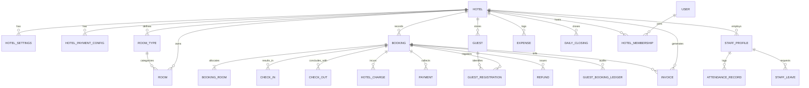

# DigitalMyHotels — Comprehensive In-Depth Technical & Architectural Documentation

> **Document Version:** 1.0.0  
> **Repository:** `shilpgohil/Digitalmyhotels`  
> **Target Audience:** Core Engineering Team, Solutions Architects, Tech Leads, and Auditors  
> **Stack Summary:** Next.js 15 (App Router, Turbopack, React 19) · FastAPI 0.115 (Python 3.12) · PostgreSQL (Neon Serverless with asyncpg) · Backblaze B2 / Cloudflare R2 Object Storage · Vercel Global Edge · Render PaaS

---

## Table of Contents

1. [Executive Overview & Vision](#1-executive-overview--vision)
2. [End-to-End System Architecture](#2-end-to-end-system-architecture)
3. [Multi-Tenancy, Security & Access Control (RBAC)](#3-multi-tenancy-security--access-control-rbac)
4. [Backend Deep-Dive (FastAPI, SQLAlchemy, Alembic)](#4-backend-deep-dive)
   - 4.1 [Database Schema & Entity-Relationship Architecture](#41-database-schema--entity-relationship-architecture)
   - 4.2 [Room Lifecycle & Status State Machine](#42-room-lifecycle--status-state-machine)
   - 4.3 [Financial Ledger & Double-Entry Accounting](#43-financial-ledger--double-entry-accounting)
   - 4.4 [Indian GST & Tax Calculation Engine](#44-indian-gst--tax-calculation-engine)
   - 4.5 [Payment Processing & Dynamic UPI QR System](#45-payment-processing--dynamic-upi-qr-system)
   - 4.6 [ID Scanning, Verification & Form C Compliance](#46-id-scanning-verification--form-c-compliance)
   - 4.7 [Staff Attendance, Geofencing & Biometric Selfie Verification](#47-staff-attendance-geofencing--biometric-selfie-verification)
   - 4.8 [Background Daemons, Automated Sweeps & Keep-Alive](#48-background-daemons-automated-sweeps--keep-alive)
5. [Frontend Deep-Dive (Next.js 15, React 19, TypeScript)](#5-frontend-deep-dive)
   - 5.1 [Architecture, Routing & State Management](#51-architecture-routing--state-management)
   - 5.2 [Session Hydration & Dual-Channel Auth Client](#52-session-hydration--dual-channel-auth-client)
   - 5.3 [Core Operational Portals & Workflows](#53-core-operational-portals--workflows)
   - 5.4 [Client-Side Deep Scan OCR Engine (Aadhaar & Verhoeff)](#54-client-side-deep-scan-ocr-engine)
   - 5.5 [Public Document Portals & Universal WhatsApp Sharing](#55-public-document-portals--universal-whatsapp-sharing)
   - 5.6 [Internationalization (i18n) & UI/UX Discipline](#56-internationalization-i18n--uiux-discipline)
6. [Super-Admin Platform Portal & Subscription Lifecycle](#6-super-admin-platform-portal--subscription-lifecycle)
7. [Infrastructure, DevOps & Production Reliability](#7-infrastructure-devops--production-reliability)
8. [Key Engineering Decisions & Architectural Invariants](#8-key-engineering-decisions--architectural-invariants)

---

## 1. Executive Overview & Vision

**DigitalMyHotels** is an enterprise-grade, multi-tenant Hotel Management Software as a Service (SaaS) tailored for independent hotels, boutique stays, and hotel chains across India and international markets.

The software addresses critical operational challenges in hospitality:
- **Fast, Error-Resistant Check-ins:** Walk-in check-in within under 60 seconds with automated ID extraction (Aadhaar QR, Passport, Driving License, PAN).
- **Zero-Discrepancy Finance:** Pure append-only ledger architecture tracking debits, credits, UPI payments, and cash drawer reconciliations.
- **GST Compliance:** Automated intra-state (CGST + SGST) and inter-state (IGST) split, supporting both tax-exclusive pricing and "GST Included by Hotel" margin extraction.
- **Biometric Staff Attendance:** Anti-proxy mobile attendance featuring GPS Haversine geofencing and facial selfie captures with privacy-preserving SHA-256 archival.
- **Extremely Low Infra Cost:** Engineered to operate efficiently within tight container memory budgets (e.g. Render 512MB RAM free tier) using a **Zero-ML server architecture** combined with client-side WebAssembly/Canvas processing.

---

## 2. End-to-End System Architecture

```
                       ┌────────────────────────────────────────────────────────┐
                       │                     CLIENT TIER                        │
                       │  Desktop Browser / Tablet / Mobile (PWA & Responsive)  │
                       └───────────────────────────┬────────────────────────────┘
                                                   │
                         HTTPS Requests / WebShare │ Static Assets / Server Pages
                                                   │
                       ┌───────────────────────────▼────────────────────────────┐
                       │               NEXT.JS 15 FRONTEND (VERCEL)              │
                       │  - App Router / Turbopack / React 19                   │
                       │  - Client-Side Tesseract OCR & Verhoeff Engine         │
                       │  - TanStack Query v5 / next-intl (English & Hindi)     │
                       │  - Reverse Proxy Rewrites: /api/* -> Backend API       │
                       └───────────────────────────┬────────────────────────────┘
                                                   │
                                     /api/* Reverse Proxy
                                     (Same-Origin Cookie)
                                                   │
                       ┌───────────────────────────▼────────────────────────────┐
                       │                FASTAPI BACKEND (RENDER)                │
                       │  - Python 3.12 / ASGI Uvicorn Engine                   │
                       │  - GZip Compression Middleware (>= 1KB)                │
                       │  - TenantContext Dependency & Multi-Tenancy Guard      │
                       │  - Argon2 Password Hasher / Fernet Data Encryptor      │
                       │  - zxing-cpp / pyaadhaar Zero-ML QR Engine             │
                       │  - fpdf2 High-Performance PDF Generator                │
                       └─────────────┬────────────────────────────┬─────────────┘
                                     │                            │
                     SQLAlchemy 2.0  │                            │ Boto3 S3 API
                        (asyncpg)    │                            │
                                     │                            │
     ┌───────────────────────────────▼────────┐   ┌───────────────▼──────────────┐
     │         NEON POSTGRESQL (DB)           │   │      OBJECT STORAGE (B2/R2)   │
     │  - Pooled Connections (PgBouncer mode) │   │  - Backblaze B2 / Cloudflare │
     │  - Append-Only Guest Ledger            │   │  - Guest ID Proofs & Selfies │
     │  - Monotonic Sequences & Row Locks     │   │  - Hotel Logos & QR Codes    │
     │  - Timezone-Aware Instant Storage      │   │  - Generated PDF Invoices    │
     └────────────────────────────────────────┘   └──────────────────────────────┘
```

### Traffic Flow & Network Boundaries
1. **Frontend Request:** The browser interacts with Next.js deployed on Vercel's global edge network.
2. **Reverse Proxying:** To prevent cross-origin cookie suppression (especially strict third-party cookie restrictions in modern browsers), Next.js `next.config.ts` rewrites `/api/:path*` to the backend target (`API_PROXY_TARGET`). All browser requests are same-origin.
3. **Dual Keep-Alive:** Render free instances sleep after 15 minutes of inactivity. DigitalMyHotels solves this through:
   - An internal self-ping daemon (`self_ping_loop`) running every 10 minutes from FastAPI hitting its own public edge URL.
   - A redundant GitHub Actions cron job running every 10–14 minutes as a cold-start failsafe.

---

## 3. Multi-Tenancy, Security & Access Control (RBAC)

### 3.1 Tenant Context Isolation
Multi-tenancy is enforced strictly at the database query layer:
- **Never Trust Client Body:** The client cannot pass an arbitrary `hotel_id` in request payloads to mutate data.
- **TenantContext Injection:** FastAPI dependencies (`get_tenant_context`) extract the JWT, query the user's active membership in `hotel_memberships`, and inject a frozen `TenantContext` containing:
  ```python
  @dataclass(frozen=True, slots=True)
  class TenantContext:
      user_id: UUID
      hotel_id: UUID | None
      role: RoleCode | None
      is_super_admin: bool
      membership_id: UUID | None = None
      access_mode: str = "full"
  ```
- **Row-Level Tenancy:** All operational queries filter explicitly by `hotel_id == tenant.require_hotel()`. Super-admin users can access platform-wide operations without hotel bindings.

### 3.2 Role-Based Access Control (RBAC)
DigitalMyHotels defines 7 distinct system roles:
1. `SUPER_ADMIN`: Complete platform authority, plan management, hotel onboarding, and database oversight.
2. `OWNER`: Full control over the hotel property, team management, UPI configuration, room rates, financial reporting, and audit logs.
3. `MANAGER`: Day-to-day operations, check-ins, check-outs, expense approvals, room statuses, staff attendance (excluding owner-only actions like reconfiguring UPI VPAs or viewing staff salary baselines).
4. `ADMIN`: Front-desk supervisor handling reservations, check-ins, guest identity verification, payments, and shift handovers.
5. `RECEPTIONIST`: Front-desk operator focused on guest registration, stay slips, room availability, and payment collection.
6. `HOUSEKEEPING`: Dedicated interface for room cleaning stages, maintenance ticketing, and personal self-attendance.
7. `GENERAL_STAFF`: Basic employee access restricted to mobile self check-in/out and personal leave applications.

### 3.3 Hotel Access Modes (Feature Gating)
Hotels can be provisioned into three functional tiers (`access_mode`):
- `checkin_only`: Express front-desk mode (check-ins, check-outs, room statuses; excludes expenses, restaurant billing, and staff attendance).
- `checkin_expense`: Financial mode (adds expense tracking, vendor management, and financial reporting; excludes staff attendance).
- `full`: Complete suite including staff attendance, geofencing, facial recognition evidence, and salary tracking.

### 3.4 Cryptography & Sensitive Data Protection
- **Password Security:** Salted hashes using **Argon2id** (`argon2-cffi`), resisting GPU brute-force attacks.
- **UPI & Guest ID Encryption:** Sensitive fields (`upi_id_encrypted`, `id_encrypted`) are encrypted using **Fernet (AES-128-CBC with HMAC-SHA256)**.
- **Zero-Downtime Key Rotation:** Supported via `MultiFernet`. The primary key encrypts new data, while previous keys remain registered to decrypt legacy ciphertexts.
- **Identity Privacy (Data Minimization):** In list and search views, guest ID proofs only display `id_last4`. The full ID is never returned unless explicitly requested by an authorized role via a dedicated, audited endpoint (`GUESTS_VIEW_FULL_ID`).
- **Session Durability & Idle Timeout:**
  - Access tokens have a long default validity (365 days) for frictionless front-desk terminal use.
  - Refresh tokens support single-use rotation with a 30-day grace window.
  - Frontends feature an automated **15-minute idle inactivity tracker** (`IdleLogout`) that clears session state if left unattended at the reception desk.

---

## 4. Backend Deep-Dive

### 4.1 Database Schema & Entity-Relationship Architecture



#### Core Data Entities:
- **`hotels`:** Base tenant record with address, timezone (default `Asia/Kolkata`), coordinates (`latitude`, `longitude`), and geofence parameters.
- **`hotel_settings`:** Check-in/check-out operational times, prefixes (`BK`, `INV`, `REG`), per-hour early/late fees, `tax_inclusive_pricing`, and `show_powered_by`.
- **`hotel_payment_config`:** Encrypted UPI ID, last 4 digits, merchant name, and Backblaze B2 object keys for pre-generated payment QR composites.
- **`rooms` & `room_types`:** Room inventory, base pricing, day-use hourly rates, extra guest surcharges, floor assignment, and active statuses.
- **`bookings`:** The central stay document storing booking numbers, stay dates, check-in/out times, occupancy, guest counts, amounts (total, advance, security deposit, due), emergency contacts, and vehicle parking details.
- **`guests` & `guest_documents`:** Normalized guest registry. Unique by `(hotel_id, normalized_phone)`. Document side tracking (`front`, `back`, `selfie`).
- **`foreign_guest_details`:** Specialized FRRO (Foreigners Regional Registration Office) Form C fields including passport number, visa details, port of entry, and arrival date in India.
- **`guest_booking_ledger`:** Strict monotonic append-only ledger tracking all credit and debit entries for every stay.
- **`staff_profiles` & `attendance_records`:** Employee directory with shift hours, departments, salaries, GPS coordinates, distance metrics, and selfie object storage keys.
- **`daily_closings` & `shift_handovers`:** Operational closure records capturing point-in-time financial snapshots (cash collected, UPI, dues, refunds, expenses).

---

### 4.2 Room Lifecycle & Status State Machine

Room status transitions are managed centrally in `app/domain/room_status.py`. Arbitrary status updates are rejected; every state change must follow the formal transition matrix:

```
                  ┌───────────────┐
                  │   AVAILABLE   │◄────────────────┐
                  └──┬─────────┬──┘                 │
       Book / Hold   │         │ Direct Walk-In     │
                     ▼         ▼                    │
             ┌──────────┐   ┌──────────┐            │
             │ RESERVED │   │ OCCUPIED │            │
             └────┬─────┘   └────┬─────┘            │
                  │ Check-In     │ Checkout         │
                  └────────►┌────▼─────────────┐    │
                            │CLEANING_REQUIRED │    │ Cleaned &
                            └────┬─────────────┘    │ Approved
                     Start Clean │                  │
                            ┌────▼──────────────┐   │
                            │CLEANING_IN_PROG.  │   │
                            └────┬──────────────┘   │
                       Finish    │                  │
                            ┌────▼──────────────┐   │
                            │    CLEAN_READY    ├───┘
                            └────┬──────────────┘
                    Inspect Flag │
                            ┌────▼──────────────┐
                            │ INSPECTION_REQ.   │
                            └───────────────────┘
```

- **Allocatable States:** Only rooms marked `available` or `clean_ready` can be assigned to a new booking or check-in.
- **Out of Service & Maintenance:** Rooms can be moved to `maintenance` or `out_of_service` from available, reserved, or cleaning states, requiring an explanatory `status_note` that is automatically cleared once restored to service.

---

### 4.3 Financial Ledger & Double-Entry Accounting

To eliminate balance drift and race conditions during concurrent front-desk transactions, guest financials are managed via `guest_booking_ledger`:
1. **Append-Only Principle:** Balances are never modified in-place. Every transaction (room rent, food charge, laundry, advance payment, checkout settlement, discount, refund) appends a new row.
2. **Monotonic Sequences:** Uses Postgres `Identity()` (`BigInteger` sequence `seq`) to guarantee strict transaction ordering even if two operations occur within the same millisecond.
3. **Audited Running Balance:** Each ledger entry stores `entry_type` (`debit` or `credit`), `amount`, and the resulting `balance_after`.
4. **Settle Function (`settle_booking_amounts`):** Sums active room rates multiplied by nights, adds non-voided hotel charges, deducts discounts, and subtracts completed payments to maintain `total_amount`, `advance_amount`, and `due_amount` on the `bookings` record under a `with_for_update()` row lock.

---

### 4.4 Indian GST & Tax Calculation Engine

Tax computations are centralized in `app/domain/gst.py` with strict Indian financial standards:
- **Whole-Rupee Quantization:** Under Indian retail conventions, all final money amounts round half-up to whole rupees (`Decimal("1")`), avoiding fractional paise discrepancies.
- **Intra-State vs. Inter-State:**
  - Intra-State (Guest within the hotel's state): `CGST (e.g. 6%) + SGST (e.g. 6%) = 12%`.
  - Inter-State (Guest from a different state): `IGST = 12%`.
- **Inclusive vs. Exclusive Pricing:**
  - **Exclusive:** Tax is added on top of the room tariff:  
    $$\text{Total} = \text{Taxable} + \text{Tax}$$
  - **Inclusive ("GST Included by Hotel"):** The gross tariff paid by the customer is preserved. Tax is extracted from within:  
    $$\text{Taxable Amount} = \operatorname{Round}\left(\frac{\text{Gross Amount} \times 100}{100 + \text{Total GST Rate}}\right)$$  
    $$\text{Total Tax} = \text{Gross Amount} - \text{Taxable Amount}$$

---

### 4.5 Payment Processing & Dynamic UPI QR System

DigitalMyHotels implements a zero-commission, direct-to-bank UPI payment framework:
- **UPI Spec Compliance:** Encodes standards-compliant `upi://pay` URIs with parameters:
  - `pa`: Merchant Virtual Payment Address (VPA).
  - `pn`: Payee business trade name.
  - `am`: Exact stay due amount (auto-locks the customer's UPI app to avoid entry mistakes).
  - `cu`: Currency (`INR`).
  - `mc`: Merchant Category Code (`5812` for hospitality).
- **High-Resolution QR Compositing:** FastAPI utilizes Pillow (`PIL`) and `qrcode` to generate QR codes with custom styling, embedding the hotel's logo at the center (with quiet zones) before streaming bytes directly or uploading to Backblaze B2.
- **Role Masking:** Front-desk staff only see the rendered QR image and the last 4 digits of the UPI VPA (`****@oksbi`). The raw UPI VPA is hidden behind the `HOTEL_VIEW_UPI_ID` permission.

---

### 4.6 ID Scanning, Verification & Form C Compliance

DigitalMyHotels implements a high-throughput ID scanning system engineered to prevent Out-Of-Memory (OOM) failures on cloud containers:
- **Zero-ML Server Policy:** Deep learning models (e.g. EasyOCR, PaddleOCR) consume 600MB–1.2GB of RAM, immediately crashing 512MB RAM containers. The backend therefore employs lightweight C++ bindings:
  - `zxing-cpp`: Blazing-fast QR decoding (< 60MB RAM footprint).
  - `pyaadhaar`: Decompresses raw byte arrays from secure Aadhaar QR codes (20,000+ byte compressed XML streams using ISO/IEC 15438 standards).
- **Client-Side Heavy Lifting:** Image binarization, rotation correction, and OCR extraction are delegated to the browser using Web Workers and Tesseract.js.
- **Coordinated Scanning Pipeline:**
  1. Front upload: Probed for QR code in 30ms.
  2. If an Aadhaar QR is found, 100% accurate digital data is extracted immediately, bypassing OCR.
  3. If no QR is present on the front (e.g., standard PVC smart cards where the QR is on the rear), the front OCR is deferred until the back side is uploaded.
  4. If the back contains the QR, digital data is extracted and OCR is completely skipped.
  5. If neither face has a QR code, full client-side OCR is triggered on both images and merged.

---

### 4.7 Staff Attendance, Geofencing & Biometric Selfie Verification

Designed for anti-proxy field and property workforce tracking:
- **Haversine Geofencing:** Validates staff GPS coordinates against the hotel's registered latitude and longitude:
  $$d = 2R \arcsin\left(\sqrt{\sin^2\left(\frac{\Delta\phi}{2}\right) + \cos(\phi_1)\cos(\phi_2)\sin^2\left(\frac{\Delta\lambda}{2}\right)}\right)$$
  Staff must be within `geofence_radius_m` (default 200m) plus an indoor signal attenuation tolerance (`accuracy_m`, capped at 150m).
- **Face Selfie Evidence:** Mobile check-in captures a live webcam/phone camera selfie uploaded directly to object storage.
- **Privacy & Storage Retention Sweep:**
  - A permanent SHA-256 hash of the selfie image is written to `attendance_records` as proof of presence.
  - A background loop (`selfie_sweep_loop`) executes nightly at **02:00 UTC (07:30 IST)**, purging binary selfie images from object storage after the hotel's retention window (configurable from 30 to 90 days) while preserving the SHA-256 fingerprint permanently for compliance audits.
- **Shift & Late Tracking:** Compares check-in time against configured shift hours with an admin-configurable grace window (default 10 minutes), automatically classifying records as `present`, `late`, `absent`, or `leave`.

---

### 4.8 Background Daemons, Automated Sweeps & Keep-Alive

FastAPI initializes background tasks within its asynchronous lifespan context:
1. **`self_ping_loop` (Interval: 10 min):** Sends an HTTP GET request to its own public URL (`/health`), preventing Render free-tier instances from falling asleep.
2. **`overdue_sweep_loop` (Interval: 15 min):** Detects stays where checkout dates/times have passed in the hotel's local timezone.
   - Emits a deduplicated operational alert (`overdue_notified_at`).
   - Automatically checks out fully-paid stays on the next business day (`sweep_auto_checkouts`).
3. **`reminders_loop` (Interval: 15 min):**
   - Alerts reception of guests arriving today (`arrival_today_sweep`).
   - Fires a notification when a guest is within 2 hours of checkout.
   - Dispatches low availability warnings when vacant rooms drop below 20%.
4. **`sweep_auto_noshow` (Runs during sweeps):** Automatically marks unfulfilled confirmed reservations as `no_show` 24 hours past the scheduled arrival date.
5. **`selfie_sweep_loop` (Daily at 02:00 UTC):** Purges aged attendance selfies from storage.

---

## 5. Frontend Deep-Dive

### 5.1 Architecture, Routing & State Management
- **Next.js 15 App Router:** Uses directory groups `(auth)`, `(partner)`, and `(super-admin)` to maintain distinct layouts and route permissions.
- **TanStack React Query v5:** Primary asynchronous data-fetching and cache-synchronization engine. Features scoped query-invalidation helpers (`invalidateMoney`, `invalidateRoomState`) ensuring atomic UI updates following mutations.
- **Tailwind CSS v4 & shadcn/ui:** Styling using modern CSS variables, responsive design, and accessible components built atop Radix UI and Base UI.

```
frontend/src/app/
├── (auth)/
│   ├── login/page.tsx               # Phone/Email login with password toggle
│   └── forgot-password/page.tsx     # Hierarchical reset request submission
├── (partner)/
│   ├── layout.tsx                   # Main frame, IdleLogout, SubscriptionGate
│   ├── dashboard/page.tsx           # Operational KPIs, quick actions, arrivals
│   ├── checkin/page.tsx             # Unified walk-in & existing check-in flow
│   ├── checkout/page.tsx            # Split-pane settlement & invoice portal
│   ├── current-guests/page.tsx      # In-house guests with overdue flags
│   ├── advance-booking/page.tsx     # Calendar reservations & rate overrides
│   ├── rooms/page.tsx               # Room status board & maintenance controls
│   ├── housekeeping/page.tsx        # Room cleaning assignments & updates
│   ├── payments/page.tsx            # Payment ledger, method split, refund ops
│   ├── restaurant-billing/page.tsx  # F&B, laundry & amenity charging interface
│   ├── expenses/page.tsx            # Operational expenses & recurring bills
│   ├── daily-closing/page.tsx       # Day-end cash/UPI audit & closing records
│   ├── shift-handover/page.tsx      # Cash drawer reconciliation between shifts
│   ├── staff/page.tsx               # Staff management & salary configuration
│   ├── my-attendance/page.tsx       # Geofenced mobile selfie check-in/out
│   ├── gst-tax/page.tsx             # Tax liability summaries & GSTR reports
│   └── settings/page.tsx            # Hotel rules, check-in times & UPI setup
├── (super-admin)/
│   ├── layout.tsx                   # Admin header & navigation
│   └── admin/page.tsx               # Multi-hotel metrics, plans & renewals
├── invoice/[id]/page.tsx            # Public printable branded invoice portal
├── stay-slip/[id]/page.tsx          # Public digital registration slip
└── voucher/[id]/page.tsx            # Public advance booking voucher
```

---

### 5.2 Session Hydration & Dual-Channel Auth Client

To prevent authentication loss from browser security policies, `frontend/src/lib/api/client.ts` implements a resilient auth system:
- **Dual-Channel Delivery:** Refresh tokens are transmitted simultaneously via **HttpOnly SameSite cookies** and an **`X-Refresh-Token` header** stored in `localStorage`. If third-party cookie restrictions strip the cookie, the header acts as an automatic fallback.
- **Zero-Flicker Session Restoration:** Returning users restore session state instantly from cached user profiles in `localStorage`, eliminating loading spinners on page reloads while token refresh occurs silently in the background.
- **Concurrent Request Locking:** If multiple parallel API requests encounter a `401 Unauthorized`, a single `refreshPromise` deduplicates the token refresh call, queueing subsequent requests until the new access token is established.

---

### 5.3 Core Operational Portals & Workflows

#### 1. Unified Check-in Engine (`/checkin`)
Supports two operational modes:
- **Mode A (Walk-in):** A single unified form that atomically creates the booking, assigns available rooms, registers the primary guest, attaches co-guests, adds initial service charges, and records the advance payment in **one database transaction** (`POST /api/v1/checkins/book-and-checkin`).
- **Mode B (Pre-booked):** Accessible via deep link or the arrivals strip. Checks in confirmed reservations, verifies ID documents, captures vehicle/emergency details, and issues room keys.

#### 2. Checkout & Settlement Portal (`/checkout`)
Implements an interactive split-pane interface:
- **Server-Authoritative Quotations:** Every charge, checkout date adjustment, or hourly late-fee calculation calls `POST /api/v1/checkouts/{id}/quote`. The client never calculates billing math locally, eliminating financial rounding errors.
- **Payment Collection & Refund:** Balances due can be settled via Cash, UPI, Credit Card, Debit Card, or Net Banking. Overpayments can be refunded in cash or credited back.
- **Instant Document Generation:** Generates downloadable PDF invoices, prints guest folios, and provides direct WhatsApp sharing links.

#### 3. Daily Closing & Shift Handover (`/daily-closing`, `/shift-handover`)
- **Timezone-Correct Snapshots:** Converts all database timestamps to the hotel's local timezone (e.g. `Asia/Kolkata`) prior to day-boundary truncation.
- **Cash Drawer Tracking:** Tracks opening cash balance, collected cash, cash expenses, cash refunds, and expected in-drawer cash balance with discrepancy alerts.

---

### 5.4 Client-Side Deep Scan OCR Engine

The browser-based document scanner in `frontend/src/lib/aadhaar-scanner.ts` features a specialized OCR pipeline:
1. **Blur Detection:** Calculates the Laplacian variance across the image canvas. Flags blurry or low-light photos before processing.
2. **Auto-Orientation:** Tests 0°, 90°, 180°, and 270° rotations against Aadhaar-specific vocabulary anchors (e.g., `Government of India`, `DOB`, `Male`, `Female`), locking onto the correct orientation.
3. **Contrast-Adaptive Thresholding:** Normalizes contrast using a 1%–99% pixel histogram stretch and local-mean binarization.
4. **Targeted Crop Extraction:**
   - Name: Single-line crop above the DOB line with strict character whitelisting.
   - Aadhaar Number: Bottom quadrant crop using digit-only OCR whitelisting.
   - Address: Left-aligned 64% canvas crop below the "Address:" label, filtering out right-hand QR code visual noise.
5. **Verhoeff Checksum & Single-Digit Repair:**
   - Validates the 12-digit UID using the mathematical Verhoeff check algorithm.
   - If a scan fails by a single digit, the algorithm iterates through a digit-confusion matrix (`CONFUSE`: e.g. 0↔8, 1↔7, 5↔6) to repair optical errors without re-scanning.

---

### 5.5 Public Document Portals & Universal WhatsApp Sharing

DigitalMyHotels allows hoteliers to share documents digitally without requiring third-party messaging APIs:
- **Public Portals:** Unauthenticated public routes (`/invoice/[id]`, `/stay-slip/[id]`, `/voucher/[id]`) display branded, mobile-responsive HTML views with print controls and PDF download triggers.
- **Universal WhatsApp Direct Links:** Generates standards-compliant `https://wa.me/91XXXXXXXXXX?text=...` deep links, avoiding desktop browser redirects and launching WhatsApp on mobile devices directly.
- **Web Share API Support:** Supports native mobile device sharing (`navigator.share`), allowing operators to attach the actual PDF file directly into chat apps on supported Android and iOS devices.

---

### 5.6 Internationalization (i18n) & UI/UX Discipline

- **Bilingual Interface:** Powered by `next-intl` with comprehensive locale definitions in English (`en.json`) and Hindi (`hi.json`).
- **Input Discipline (`input-discipline.ts`):** Automatically sanitizes input fields on keystroke:
  - Phone numbers are formatted to 10 digits without prefixes.
  - Names are converted to Title Case in real-time.
  - Aadhaar inputs format automatically with `XXXX XXXX 1234` masking.
- **Accessibility:** Fully keyboard-navigable with an accessible "Skip to Main Content" landmark, focus-visible outlines, and ARIA labels.

---

## 6. Super-Admin Platform Portal & Subscription Lifecycle

The Super-Admin portal (`/admin`) equips platform operators to manage SaaS subscriptions:
- **Multi-Tenant Dashboard:** Displays cross-hotel platform metrics including Total Revenue, Active Properties, Check-ins Today, and Expiring Subscriptions.
- **Subscription Lifecycle States:**
  - `trial`: Initial onboarding window (default 14 days).
  - `active`: Paid subscription with more than 7 days remaining.
  - `expiring_soon`: Active subscription within 7 days of expiry.
  - `in_grace`: Past expiry date, operating under grace-period wind-down (default 7 days).
  - `expired`: Past grace period; read-only access with transaction blocking.
  - `suspended`: Manually deactivated by platform administrators.
- **Partner Renewal Flow:**
  1. Hotel owners view available tiers (Monthly, Quarterly, Annual) with discounted prices and strikethrough MRP badges.
  2. The hotel pays the platform UPI VPA displayed on the screen.
  3. The hotel submits a renewal request with transaction reference numbers.
  4. Platform admins review and approve requests from the admin portal, instantly extending the hotel's subscription period.

---

## 7. Infrastructure, DevOps & Production Reliability

### 7.1 Production Deployment Configuration

| Component | Provider | Region | Configuration Notes |
| :--- | :--- | :--- | :--- |
| **Backend API** | Render | Singapore (`ap-southeast-1`) | Free web service running FastAPI via Uvicorn. Keep-alive loop active. |
| **Database** | Neon | Singapore (`ap-southeast-1`) | Serverless Postgres with connection pooler URL. |
| **Object Storage** | Backblaze B2 | Singapore (`sg-sin-001`) | S3-compatible public bucket for documents, images, and logos. |
| **Frontend** | Vercel | Global Anycast CDN | Next.js 15 SSR & static assets with API rewrites. |

### 7.2 Database Connection Pool Optimization
- **The Challenge:** Establishing fresh TCP + TLS + SCRAM handshakes to Neon database instances incurs a ~3-second latency penalty per request.
- **The Solution:** The backend maintains a small persistent connection pool (`pool_size=3`, `max_overflow=2`, `pool_recycle=240`, `pool_pre_ping=True`) keeping database connections alive.
- **PgBouncer Compatibility:** Because Neon's pooled connection strings run PgBouncer in transaction mode, the backend sets `statement_cache_size=0` on `asyncpg` to prevent prepared-statement collisions.

---

## 8. Key Engineering Decisions & Architectural Invariants

1. **Client-Side Heavy Processing vs. Cloud Cost:** Document OCR and image compression occur inside the guest's or staff member's browser via Canvas and WebAssembly. This allows the server backend to run comfortably within 512MB RAM without risking out-of-memory container crashes.
2. **Server-Authoritative Financial Math:** No financial balances, discounts, tax splits, or checkout amounts are computed client-side. The frontend acts purely as a display layer, rendering server responses verbatim.
3. **Strict Timezone Handling:** Hotel operations run on local property time. All business dates, shift turnovers, daily audits, and check-in/out timestamps are evaluated against the hotel's IANA timezone (`Asia/Kolkata`) rather than UTC midnight.
4. **Append-Only Accounting Records:** Guest ledger rows are never updated or deleted. Corrections create new offsetting entries, preserving a tamper-evident audit trail for financial accountability.
5. **Privacy-Preserving Archival:** Facial verification selfies are stripped from binary object storage on a scheduled retention window, while cryptographic SHA-256 hashes are preserved permanently in the database to satisfy identity audit requirements.
